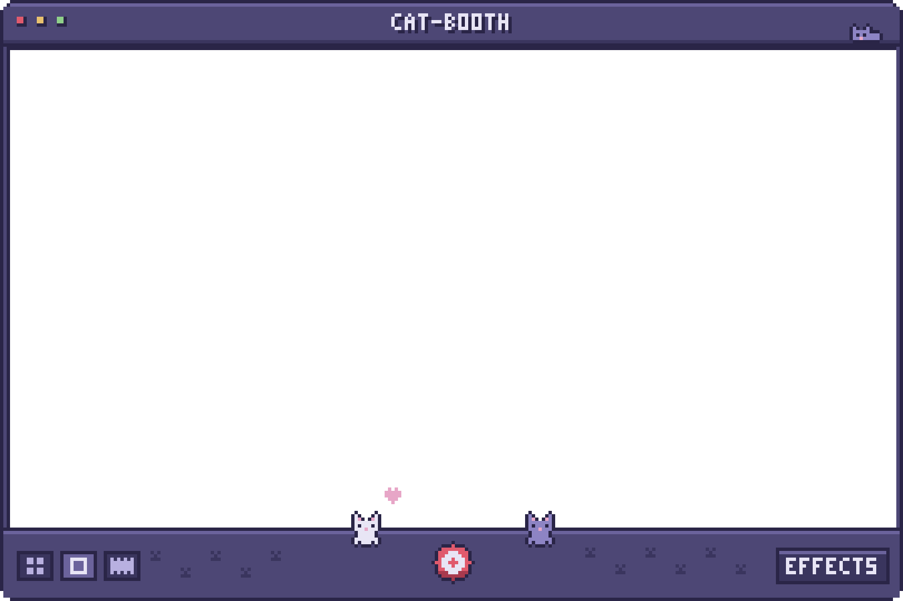

<div align="center">

# 🐱 catbooth

**Wrap any video in a pixel-art Photo Booth window — Nintendo DS cat edition.**


</div>

---

<p align="center"></p>

## ✨ What it does

`catbooth` draws a retro purple Photo Booth window entirely in code — title bar, traffic lights, pixel cat, camera button, custom 3×5 pixel font — then composites your video into it with ffmpeg. No image assets: every sprite is defined as data in the script.

## 🚀 Usage

```bash
python3 catbooth.py input.mov                 # -> framed video
python3 catbooth.py input.mov -o out.mp4      # choose output name
python3 catbooth.py input.mov --alpha         # ProRes 4444 .mov with transparent rounded corners
python3 catbooth.py input.mov --fit           # letterbox instead of crop-to-fill
python3 catbooth.py input.mov --frame-only    # just export the frame PNG
```

## 📦 Requirements

| Tool | Why |
|------|-----|
| Python 3 + [Pillow](https://pypi.org/project/pillow/) | Draws the pixel-art frame |
| `ffmpeg` / `ffprobe` on `PATH` | Probes and composites the video |

```bash
pip install pillow
brew install ffmpeg
```

## 🎨 Palette

Built around a single base color, `#4d4775`, with highlights, shadows, and a soft-pink accent for the cat's ears and nose.

---

<div align="center"><sub>Made by <a href="https://github.com/emmanuelhuff7">@emmanuelhuff7</a></sub></div>
